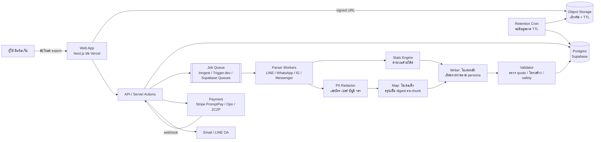
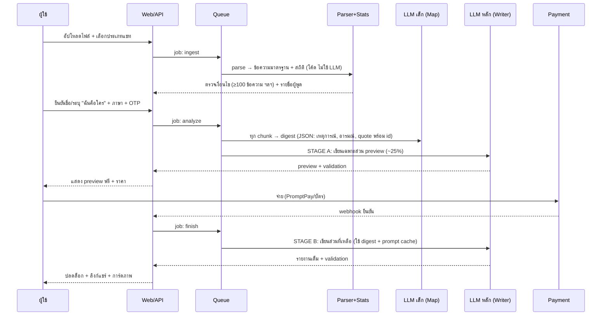

# 02 · สถาปัตยกรรมระบบและต้นทุน LLM

> สถานะ: ร่างเทคนิค · วันที่: 2026-11-19
> **คำเตือนเรื่องตัวเลข:** ราคาโมเดล อัตราแลกเปลี่ยน ค่าธรรมเนียมชำระเงิน และจำนวนโทเคนต่อข้อความ ในเอกสารนี้เป็น **สมมติฐานเพื่อประกอบการออกแบบ** ไม่ใช่ราคาจริง ต้องตรวจราคาผู้ให้บริการปัจจุบัน แล้วแก้ไขในไฟล์ `cost_model.py` และรันใหม่ก่อนตัดสินใจเรื่องราคา

## 1. เป้าหมายทางเทคนิค

1. อ่านแชทยาว (หลักหมื่นข้อความ) ได้ในต้นทุนที่คุมได้
2. คุณภาพรายงาน: ตรง ไม่ประจบ ไม่มั่ว (quote ต้องมีจริง)
3. **ความเป็นส่วนตัวเป็นค่าเริ่มต้น**: เก็บข้อมูลดิบให้สั้นที่สุด ลบจริง
4. ตอบเร็ว: preview ภายใน ~1–3 นาที (สมมติฐาน) รายงานเต็มตามหลังจ่าย
5. ทีมเล็กดูแลไหว (ใช้บริการแบบ managed)

## 2. สถาปัตยกรรมโดยรวม



### 2.1 ทางเลือกเทคโนโลยี (เหตุผลย่อ)

| ชั้น | แนะนำ | เหตุผล | ทางเลือก |
|---|---|---|---|
| Frontend | **Next.js (React) + Tailwind**, PWA | SEO ดี, ทำ share-card ฝั่ง server (OG image) ได้, ทีมเล็กเดินเร็ว | Astro (เหมาะกับหน้า marketing/บล็อก ต้นแบบในรีโปนี้) + React islands สำหรับแอป |
| Backend | Next.js Route Handlers/Server Actions + worker แยกสำหรับงานหนัก | งานวิเคราะห์ยาวเกินเวลา serverless ปกติ ต้องแยกเป็น job | Node worker บน Fly.io/Railway/Cloud Run |
| DB/Auth/Storage | **Supabase** (Postgres + RLS + Storage + Auth) | ครบ จัดการง่าย เลือก region ใกล้ไทย (Singapore) ลด latency | Neon + S3 + Auth.js |
| Queue | Inngest หรือ Trigger.dev | retry/backoff/step function ในตัว เหมาะกับ pipeline หลายขั้น | BullMQ + Redis |
| LLM | Anthropic API (เขียนรายงาน/ตรวจ) + โมเดลเล็ก/เร็ว (map/classify) ผ่าน abstraction layer | คุณภาพภาษาไทยและการทำตามโทน/ข้อจำกัด; เปลี่ยนผู้ให้บริการได้ | Gemini/OpenRouter เป็น fallback (ตรวจนโยบายข้อมูล/เทรนทุกเจ้า) |
| Payment | **Stripe (PromptPay + บัตร)** หรือ Opn Payments/2C2P สำหรับ TrueMoney/Rabbit LINE Pay ฯลฯ | PromptPay QR คือวิธีจ่ายหลักของผู้ใช้ไทย | ตรวจเงื่อนไขการเปิดบัญชี/ค่าธรรมเนียมจริงกับแต่ละเจ้า |
| Email | Resend | | SES |
| Monitoring | Sentry + log structured (ห้ามใส่เนื้อแชทใน log) | | |
| Bot | LINE Messaging API (Official Account) | สำหรับ Membership/แจ้งเตือน | |

### 2.2 ขอบเขตความเชื่อใจ (Trust boundaries)
- เนื้อแชทดิบอยู่เฉพาะ: Object Storage (เข้ารหัส), หน่วยความจำ worker, และคำขอไปยังผู้ให้บริการ LLM ที่เลือกแล้ว — **ไม่อยู่ใน log, ไม่อยู่ใน analytics, ไม่อยู่ใน Sentry**
- ชื่อบุคคลถูกแปลงเป็น alias (`P1`, `P2`) ระหว่างประมวลผล แล้วค่อยแทนชื่อกลับตอนแสดงผล ลดข้อมูลระบุตัวตนที่ส่งออกไปให้ LLM
- ลิงก์แชร์รายงานชี้ไปที่ "รายงาน" ซึ่งเป็นข้อมูลที่ derived แล้ว ไม่ชี้ไปที่แชทดิบ

## 3. Pipeline การสร้างรายงาน (staged)



### 3.1 เหตุผลที่ต้อง "staged"
คู่แข่งอธิบายเองว่าเขารันการวิเคราะห์และเขียนรายงานเต็มก่อนให้ preview ซึ่งต้นทุนเกิดขึ้นกับ **ทุก upload** ไม่ใช่เฉพาะคนที่จ่าย ในตลาดไทยที่ราคาต่อรายงานต่ำกว่า จุดคุ้มทุนของ conversion จะสูงขึ้น (ดูตารางหมวด 5) ดังนั้น:
- **ขั้น A (ก่อนจ่าย):** แปลงแชทเป็น digest ด้วยโมเดลเล็ก + เขียนเฉพาะส่วน preview ด้วยโมเดลหลัก
- **ขั้น B (หลังจ่าย):** เขียนส่วนที่เหลือโดยใช้ digest ที่มีอยู่แล้ว (+ prompt caching ของ context ชุดเดิม)
- ข้อแลกเปลี่ยน: preview ต้อง "ดีพอจะซื้อ" และส่วนที่เหลือต้องไม่ขัดแย้งกับ preview → ใช้ outline ที่ล็อกจากขั้น A เป็น input ของขั้น B

### 3.2 Chunking และ Map-Reduce
- แบ่งตามเวลา/ช่องว่างของบทสนทนา (session break เมื่อเงียบเกิน N ชั่วโมง) ไม่ตัดกลางประโยค
- ทุก chunk ได้ digest เป็น JSON ตาม schema: `events[]`, `tone`, `conflicts[]`, `affection_signals[]`, `quotes[{id,speaker,text,why}]`
- `quotes` ต้องอ้าง `message_id` เพื่อให้ validator เทียบกับต้นฉบับ
- Chunk ใหญ่ ≈ 30k โทเคน (สมมติ) ปรับตามคุณภาพจริง
- แชทสั้น: ส่งเข้า Writer ตรง ๆ เพื่อคงรายละเอียด — เกณฑ์ตั้งต้นในสคริปต์คือ ≤120k โทเคน แต่หมวด 5.3 ข้อ 4 ชี้ว่าการทำ digest ด้วยโมเดลเล็กก่อนถูกกว่า จึงต้องทดลองลดเกณฑ์ลง (เช่น 40k) แล้ววัดคุณภาพ
- แชทยาวเกินเพดาน (แนะนำ cap ที่ ~25,000 ข้อความล่าสุดใน MVP): ใช้ข้อความล่าสุด + สุ่มช่วงเก่าที่มีเหตุการณ์สำคัญ แล้วบอกผู้ใช้ตรง ๆ ในรายงานว่าอ่านช่วงไหน

### 3.3 Validator (ต้องมีตั้งแต่ MVP)
1. **Quote check**: ทุก quote ในรายงานต้อง match ข้อความจริง (fuzzy ตามช่องว่าง/อีโมจิ) ถ้าไม่ตรง → ตัดทิ้งหรือส่งกลับให้ regenerate
2. **ตัวเลขตรงกับ Stats Engine**: ตัวเลขทุกตัวในรายงานดึงจากสถิติที่คำนวณด้วยโค้ด ไม่ให้ LLM คิดเลขเอง
3. **Schema check**: โครงสร้างหัวข้อครบ ภาษาตรงตามที่เลือก
4. **Safety check**: ตรวจ self-harm/ความรุนแรง/ผู้เยาว์ → เปลี่ยนโหมด (ดู `01` หมวด 7.3)
5. **Anti-flattery check**: บังคับให้ต้องมีอย่างน้อยหนึ่งประเด็นที่ไม่เข้าข้างผู้อัปโหลด (ถ้าข้อมูลรองรับ)
6. **Eval set**: ชุดแชทสมมติ 100–200 ชุด (หลายประเภท/ภาษา/กรณีขอบ) รันทุกครั้งที่เปลี่ยน prompt/โมเดล เปรียบเทียบด้วยเกณฑ์ + LLM-judge + ตรวจมือสุ่ม

### 3.4 การเขียน prompt/persona
- Persona spec: บุคลิก ภาษา (ภาษาพูดไทย/คำลงท้าย/มุก) ขอบเขตที่ห้ามพูด โทนตามประเภทแชท ตัวอย่างดี/แย่ (few-shot)
- แยก "system persona" ออกจาก "task schema" เพื่อเปลี่ยนตัวละครโดยไม่แตะ pipeline
- Version prompt/persona ทุกชุด (เก็บ hash ลง DB ต่อรายงาน) เพื่อไล่ปัญหาย้อนหลัง

## 4. การแยกวิเคราะห์ไฟล์ (Parsers)

> ต้องเก็บ **ไฟล์ตัวอย่างจริง** จากอุปกรณ์/ภาษาหลายแบบ ก่อนเขียน parser เพราะรูปแบบวันที่/เวลา/ปีพุทธศักราช/ชื่อคนเปลี่ยนตามภาษาเครื่องและเวอร์ชันแอป รายละเอียดด้านล่างคือแนวทาง ไม่ใช่สเปกที่ยืนยันแล้ว

| แอป | ไฟล์ที่คาดว่าจะได้ | ประเด็นที่ต้องจัดการ |
|---|---|---|
| LINE | `.txt` จาก "ส่งประวัติการแชท" | ส่วนหัวมีวันที่เป็นบรรทัด แล้วตามด้วยบรรทัด เวลา–ชื่อ–ข้อความ คั่นด้วยแท็บ (รูปแบบอาจต่างตามภาษา); ข้อความหลายบรรทัด; สติกเกอร์/รูป/เสียงเป็น placeholder; ชื่อกลุ่ม/ชื่อที่เปลี่ยน; ปี พ.ศ. |
| WhatsApp | `.txt` (หรือ `.zip` ถ้ารวมสื่อ) | รูปแบบเวลา 12/24 ชม. และ locale ต่างกัน; ข้อความหลายบรรทัด; ข้อความระบบ ("เข้ารหัสต้นทางถึงปลายทาง", "ออกจากกลุ่ม") |
| Instagram / Messenger | JSON จาก "ดาวน์โหลดข้อมูลของคุณ" | UTF-8 ถูก decode ผิด (latin-1 ซ้อน) ต้องแก้; ข้อความถูกแบ่งหลายไฟล์; กลับลำดับเวลา |
| iMessage | ต้องใช้เครื่องมือ export (Mac) | ขั้นตอนยาก ทำทีหลัง |

แนวทาง: parser เป็นฟังก์ชันบริสุทธิ์ `parse(file) -> {participants, messages[{id, ts, sender, text, type}], warnings[]}` + **property tests** + ชุดไฟล์ตัวอย่างสมมติ (ห้ามใช้แชทจริงของคนอื่นใน repo) ถ้า parse ไม่ได้ให้บอกผู้ใช้ว่าพลาดตรงไหน (ไม่ใช่ error ทั่วไป)

## 5. โมเดลต้นทุน LLM

คำนวณด้วย `cost_model.py` (ไฟล์เดียวกันนี้) ภายใต้สมมติฐาน:
- โทเคนต่อข้อความ ≈ 22 (ข้อความไทย + ชื่อ + เวลา แบบย่อ) — **ต้องวัดจริง** ด้วย tokenizer ของโมเดลที่เลือก
- โมเดลเล็ก (map): ราคาสมมติ in $0.25 / out $1.25 ต่อ 1M โทเคน
- โมเดลหลัก (writer): ราคาสมมติ in $3 / out $15 ต่อ 1M โทเคน
- รายงานเต็ม 7,000 โทเคน output, preview = 25%
- ค่า retry/validation ×1.15, 1 USD = ฿35, ค่าธรรมเนียมชำระเงินเฉลี่ย 3.5%, ราคารวม VAT 7% (ถ้าจดภาษี)
- แชทสั้น (≤120k โทเคนในสคริปต์นี้) ให้ writer อ่านตรง

### 5.1 ผลลัพธ์ (ราคา LLM = ตามสมมติฐาน ×1.0)

| ขนาด | ข้อความ | โทเคน | ก่อนจ่าย ฿ | หลังจ่าย ฿ | "เต็มก่อน" ฿ | ราคาขาย ฿ | สุทธิ ฿ | margin (staged) | conv คุ้มทุน (staged) | conv คุ้มทุน (เต็มก่อน) |
|---|---|---|---|---|---|---|---|---|---|---|
| S | 1,500 | 33,000 | 6.3 | 3.7 | 9.3 | 59 | 53.2 | 81% | 12.7% | 17.5% |
| M | 6,000 | 132,000 | 5.8 | 3.4 | 8.9 | 99 | 89.3 | 90% | 6.8% | 9.9% |
| L | 20,000 | 440,000 | 13.4 | 3.7 | 16.4 | 149 | 134.4 | 87% | 10.2% | 12.2% |
| XL (cap 25k) | 25,000 | 550,000 | 16.2 | 3.9 | 19.3 | 149 | 134.4 | 85% | 12.4% | 14.3% |

### 5.2 ความไวต่อราคา LLM

| ตัวคูณราคา LLM | S: conv คุ้มทุน (staged) | M | L | XL |
|---|---|---|---|---|
| ×0.5 (ถูกลง/ใช้โมเดลเล็กลง) | 6.2% | 3.4% | 5.1% | 6.2% |
| ×1.0 (สมมติฐานฐาน) | 12.7% | 6.8% | 10.2% | 12.4% |
| ×2.0 (แพงขึ้น/โมเดลแรงกว่า) | 27.0% | 14.0% | 20.9% | 25.5% |

### 5.3 สิ่งที่ตัวเลขนี้บอก (และไม่บอก)
1. **conv คุ้มทุน = สัดส่วนผู้ upload ที่ต้องจ่าย เพื่อให้ผู้จ่ายครอบคลุมต้นทุน LLM ของทุกคน** ถ้า conversion จริงต่ำกว่านี้ ขาดทุนต่อหน่วย แม้ margin ต่อผู้จ่ายจะดูสูง
2. ที่ราคาสมมติฐานฐาน ต้องการ conversion ~7–13% — ยังไม่ทราบว่าจริงเป็นเท่าไร ต้องวัดใน Phase 1
3. ถ้าต้นทุน LLM แพงเป็น 2 เท่า (เช่น ใช้โมเดลแรงกว่าสำหรับทุกขั้น) แชทขนาดเล็กที่ราคา ฿59 จะต้องการ conversion ~27% ซึ่งไม่น่าสมจริง → ต้องปรับ **ราคา, ขนาด preview, หรือโมเดล**
4. **ข้อสังเกตเชิงสถาปัตยกรรม:** S ต้นทุนสูงกว่า M ในตารางเพราะ S ใช้ writer อ่านตรง ส่วน M ใช้ map ด้วยโมเดลเล็ก — แสดงว่า **การใช้โมเดลเล็กทำ digest ก่อน แม้แชทสั้น** ช่วยลดต้นทุนมาก แต่ต้องวัดผลกระทบต่อคุณภาพ (รายละเอียดเล็ก ๆ อาจหาย) ก่อนตั้งเกณฑ์ single-pass
5. ตัวเลขนี้ **ไม่รวม**: ค่า infra/DB/storage, ค่า CAPTCHA/SMS, ค่าโฆษณาและค่าได้ลูกค้า, ค่าซัพพอร์ต, การคืนเงิน, การใช้ฟรีเกินปกติ, ค่า LLM ของ Investigation ฉบับต่อ ๆ ไป, และ eval/ทดสอบ

### 5.4 วิธีลดต้นทุน (เรียงตามผลต่อกำไร)
1. **Staged generation** (หมวด 3.1) — ผลใหญ่สุดต่อ non-payers
2. **ใช้โมเดลเล็กสำหรับงาน map/classify/validator**, โมเดลหลักเฉพาะขั้นเขียน
3. **Prompt caching** สำหรับ system persona + digest ชุดเดียวกัน (ใช้ตอนขั้น B และ Investigation ฉบับต่อ)
4. **เก็บ "digest" แทนการอ่านแชททั้งหมดใหม่** ตอนฉบับต่อ — ถูกกว่ามาก แต่ digest เป็นข้อมูลที่ derive จากแชท ต้องอยู่ในนโยบายลบ/ความยินยอมด้วย (ดู `01` หมวด 7.1)
5. จำกัด preview ที่ความยาวคงที่ (ไม่ให้เกินสัดส่วนที่คาดไว้)
6. Cap จำนวนข้อความและเตือนผู้ใช้
7. ลดความยาวรายงาน (7k โทเคน output คือค่าใหญ่ในหมวดนี้) ทดลอง A/B ว่ารายงานสั้นลง 30% กระทบความพึงพอใจไหม
8. Batch API/โมเดลราคาถูกในช่วง off-peak สำหรับงานที่ไม่เร่ง (เช่น Investigation ที่ยอมรอ)
9. Rate limit + OTP ก่อนประมวลผล เพื่อกัน abuse ที่ทำให้ต้นทุนบาน

## 6. โมเดลข้อมูล (ร่าง)

```sql
-- ผู้ใช้
create table users (
  id uuid primary key default gen_random_uuid(),
  email text unique,
  line_user_id text unique,
  locale text default 'th',
  created_at timestamptz default now(),
  deleted_at timestamptz
);

-- การอัปโหลด/บทสนทนา (ไฟล์ดิบอยู่ใน storage ลบตาม delete_after)
create table conversations (
  id uuid primary key default gen_random_uuid(),
  user_id uuid references users(id) on delete cascade,
  source_app text not null check (source_app in ('line','whatsapp','instagram','messenger','imessage')),
  chat_type text not null check (chat_type in ('romantic','friends_group','friend','family','work','other')),
  participant_count int not null,
  message_count int not null,
  token_estimate int not null,
  storage_path text,                 -- ไฟล์ดิบ (เข้ารหัส) ว่างเมื่อลบแล้ว
  delete_after timestamptz not null, -- 48 ชม. ถ้าไม่ซื้อ / 7 วันหลังรายงานล่าสุด
  consent_version text not null,
  created_at timestamptz default now()
);

-- ผู้พูดใน conversation (alias สำหรับส่งให้ LLM)
create table participants (
  id uuid primary key default gen_random_uuid(),
  conversation_id uuid references conversations(id) on delete cascade,
  alias text not null,               -- 'P1','P2'
  display_name text,                 -- ชื่อจริงใช้ตอนแสดงผลเท่านั้น
  is_uploader boolean default false
);

-- digest ที่ derive จากแชท (ผูกกับนโยบายลบ)
create table digests (
  id uuid primary key default gen_random_uuid(),
  conversation_id uuid references conversations(id) on delete cascade,
  chunk_index int not null,
  payload jsonb not null,            -- events/quotes (quotes ต้องอ้าง message_id)
  model text not null,
  prompt_version text not null
);

-- รายงาน
create table reports (
  id uuid primary key default gen_random_uuid(),
  conversation_id uuid references conversations(id) on delete cascade,
  seq int not null,                  -- ลำดับในการ investigation
  persona text not null,
  language text not null,
  status text not null check (status in ('queued','preview_ready','paid','generating','ready','failed','refunded')),
  preview_json jsonb,
  full_json jsonb,
  share_token text unique,           -- สุ่มยาว เพิกถอนได้
  share_revoked_at timestamptz,
  model_cost_usd numeric(10,5),      -- ใช้คำนวณ margin จริง
  prompt_version text,
  created_at timestamptz default now()
);

-- การชำระเงิน
create table payments (
  id uuid primary key default gen_random_uuid(),
  report_id uuid references reports(id),
  user_id uuid references users(id),
  provider text, provider_ref text unique,
  amount_thb int not null, vat_included boolean default true,
  method text, status text, paid_at timestamptz,
  refunded_at timestamptz
);

-- ตรวจ abuse / ต้นทุนต่อวัน
create table usage_ledger (
  id bigserial primary key,
  day date, actor_hash text, stage text,
  tokens_in int, tokens_out int, cost_usd numeric(10,5)
);
```

หมายเหตุ: เปิด **Row Level Security** ทุกตาราง; ผู้ใช้เห็นเฉพาะแถวของตัวเอง; การอ่านด้วยลิงก์แชร์ผ่าน Edge Function ที่ตรวจ `share_token` เท่านั้น; ตาราง `usage_ledger` ใช้ `actor_hash` ไม่เก็บ IP ดิบ

## 7. API (ร่าง)

| Method | Path | หน้าที่ |
|---|---|---|
| POST | `/api/uploads` | ขอ signed URL อัปโหลด + สร้าง conversation (draft) |
| POST | `/api/uploads/:id/parse` | trigger parse, คืนรายชื่อผู้พูด/คำเตือน |
| POST | `/api/conversations/:id/confirm` | ยืนยันชื่อ/ฉันคือใคร/ภาษา/ประเภท + ผูกอีเมล (OTP) |
| GET | `/api/reports/:id` | สถานะ + preview (หรือเต็มถ้าจ่ายแล้ว) |
| POST | `/api/reports/:id/checkout` | สร้างรายการชำระ (PromptPay/บัตร) |
| POST | `/api/webhooks/payment` | รับ webhook (ตรวจลายเซ็น, idempotent) |
| POST | `/api/conversations/:id/continue` | สั่งรายงานถัดไป (บริบท/ข้อความใหม่) |
| POST | `/api/reports/:id/share` / `DELETE` | สร้าง/เพิกถอนลิงก์แชร์ |
| DELETE | `/api/conversations/:id` | ลบแชท (คงรายงานได้) |
| DELETE | `/api/account` | ลบบัญชีทั้งหมด |

## 8. ความปลอดภัยและการดำเนินงาน

- **ลบข้อมูลจริง**: cron ทำงานตาม `delete_after`; ลบทั้ง storage, `digests` ที่เกี่ยวข้อง (หรือย้ายเป็น "memory" เฉพาะเมื่อผู้ใช้ยินยอมให้ต่อ Investigation); ตั้งอายุ backup สั้นและบันทึกในนโยบาย
- **เข้ารหัส**: TLS ตลอด, encryption at rest, คีย์แยกต่อสภาพแวดล้อม; พิจารณา envelope encryption ของไฟล์แชท
- **Log ห้ามมีเนื้อแชท**: ตรวจด้วย lint/test ที่ล้ม build ถ้ามี `console.log` ของ payload
- **สิทธิ์ภายใน**: พนักงานไม่เปิดอ่านแชท; ถ้าต้องดีบักให้ใช้ไฟล์สังเคราะห์/ผู้ใช้อนุญาตเป็นครั้ง ๆ + audit log
- **Abuse**: OTP ก่อนเริ่มประมวลผล, rate limit ต่อ IP/อุปกรณ์/อีเมล, งบ LLM รายวันพร้อม circuit breaker, ตรวจ hash ไฟล์ซ้ำ
- **Payments**: เก็บเฉพาะ reference/ยอด ไม่เก็บข้อมูลบัตร; webhook idempotent; กระทบยอดรายวัน
- **Observability**: metric ต่อขั้น (latency, cost, fail rate), dashboard margin รายวันจาก `model_cost_usd`, alert เมื่อ cost/upload เกินเกณฑ์
- **เอกสาร/ข้อตกลง**: DPA กับผู้ให้บริการ LLM/Supabase/Vercel/Stripe; บันทึกกิจกรรมประมวลผล (ROPA) ตาม PDPA
- **ทดสอบ**: parser (property tests), validator, eval set, e2e บนอัปโหลด→จ่าย→ปลดล็อก (Playwright), โหลดเทสต์ขั้นพื้นฐาน

## 9. แผนต่อยอดเชิงเทคนิค
| เรื่อง | แนวทาง |
|---|---|
| LINE OA (Membership) | webhook → จัดคิว → ตอบด้วย persona; ใช้ digest/memory ที่ผู้ใช้ยินยอม; ค่าข้อความ LINE OA ต้องคำนวณใน margin |
| Share Extension / PWA | Web Share Target API ให้รับไฟล์จากแอปแชทโดยตรงบน Android; iOS ใช้ Shortcuts/แอป native ภายหลัง |
| Ultimate หลายแชท | reduce ข้ามหลาย digest set (ไม่รวมแชทดิบ) → เขียนรายงานเดียว |
| ไทม์ไลน์ความสัมพันธ์ | เก็บตัวชี้วัดต่อรายงานเป็น time series (ไม่เก็บข้อความ) |
| Multi-region | แยกตารางราคา/ภาษา/ผู้ให้บริการชำระเงินต่อประเทศตั้งแต่ต้น |
